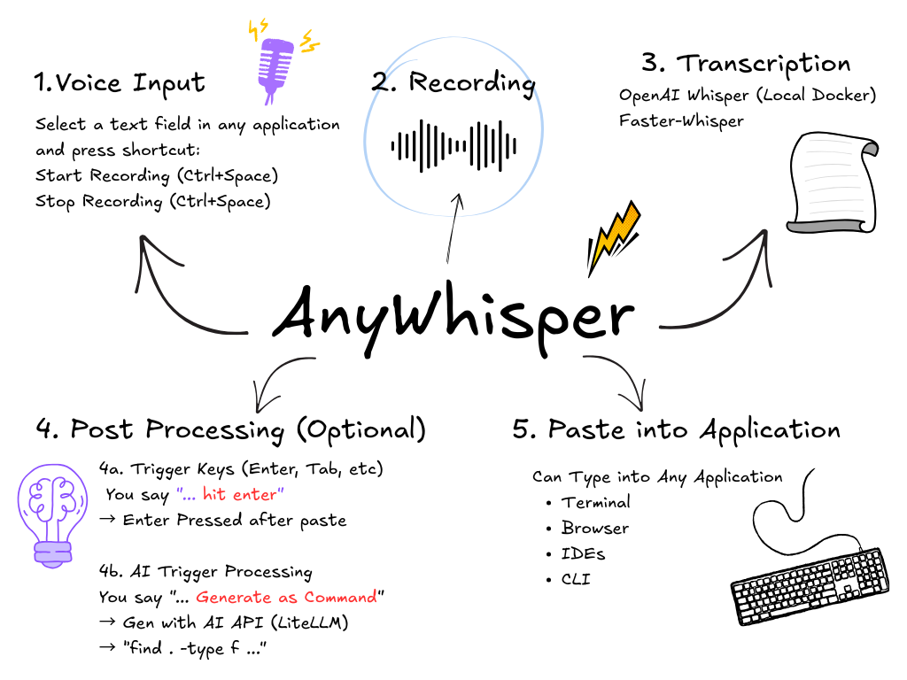

# AnyWhisper

A seamless voice-to-text application that uses OpenAI's Whisper model (locally) for high-quality speech recognition and types your words into any application. It can also post-process your transcription with AI based on trigger phrases before typing the final result.



1. Select an input field and press a keyboard shortcut,
2. Speak,
3. and have your words automatically typed into the input field.

## Prerequisites

- Ubuntu 20.04+ (Debian-based)
- Python 3.8+
- Docker
- Microphone

## Installation

### 1. Whisper API (Docker)

```bash
docker build -t whisper-assistant .
docker run -d -p 127.0.0.1:4444:4444 --name whisper-assistant whisper-assistant
```

The default model is `small` (244M params, CPU). Change `WHISPER_MODEL_SIZE` in the Dockerfile for other sizes.

### 2. Application Setup

```bash
chmod +x setup.sh
./setup.sh
```

This installs system packages, creates a Python venv, installs dependencies, and sets up udev rules for `/dev/uinput`.

### 3. Configuration

```bash
cp .env.example .env
# Edit .env with your settings
```

### 4. Autostart (systemd)

```bash
./setup_autostart.sh
```

This creates two systemd user services (`ydotoold` + `any-whisper`), installs the udev rule, and adds your user to the `input` group.

### 5. Global Shortcut

Bind a keyboard shortcut to the trigger script in your desktop environment:

- **GNOME**: Settings -> Keyboard -> Custom Shortcuts
- **KDE**: System Settings -> Shortcuts -> Custom Shortcuts
- **Command**: `/path/to/AnyWhisper/voice_trigger.py`

## Configuration Reference

All scalar settings are read from `.env` (see `.env.example`). Complex structures stay in `config.py`.

| Variable | Default | Description |
|---|---|---|
| `WHISPER_API_URL` | `http://localhost:4444/v1/audio/transcriptions` | Whisper API endpoint |
| `SAMPLE_RATE` | `16000` | Audio sample rate (Hz) |
| `MAX_RECORDING_DURATION` | `240` | Max recording length (seconds) |
| `SILENCE_THRESHOLD` | `0.01` | Silence detection sensitivity (0.0-1.0) |
| `SILENCE_DURATION` | `4.0` | Silence before auto-stop (seconds) |
| `ENABLE_NOTIFICATIONS` | `true` | Desktop notifications |
| `USE_COPY_PASTE_METHOD` | `true` | Clipboard paste (fast) vs char-by-char typing |
| `LOG_LEVEL` | `INFO` | Logging verbosity |
| `ENABLE_TRANSCRIPTION_ACTIONS` | `true` | Post-transcription key actions |
| `ENABLE_AI_PROCESSING` | `true` | AI enhancement of transcriptions |
| `AI_API_KEY` | *(empty)* | API key for your LLM provider |
| `AI_PROVIDER` | `gemini` | LLM provider (gemini, openai, anthropic, groq, etc.) |
| `AI_MODEL_NAME` | `gemini-2.5-flash-lite` | Model name (without provider prefix) |
| `SOCKET_PATH` | `/tmp/voice_to_text.sock` | Daemon socket path |

## Post-Transcription Actions

Spoken phrases can trigger key presses after typing. Configured in `POST_TRANSCRIPTION_ACTIONS` in `config.py`:

| Say | Types | Then presses |
|---|---|---|
| "send a message **hit enter**" | `send a message` | ENTER |
| "john@example.com **press tab**" | `john@example.com` | TAB |
| "**enter**" | *(nothing)* | ENTER |

Set `POST_TRANSCRIPTION_OPT_DOT=true` (default) to handle periods Whisper sometimes adds.

## AI Processing

Trigger AI processing with spoken phrases. Configured via `POST_AI_TRIGGERS` and `AI_PROMPT_TEMPLATES` in `config.py`:

| Trigger phrase | Template | Use case |
|---|---|---|
| "... **whisper with ai**" | GEN_AI_TEMPLATE | General AI generation |
| "... **generate this as prompt**" | ENHANCE_PROMPT_TEMPLATE | Prompt engineering |
| "... **generate as command**" | COMMAND_GENERATION_TEMPLATE | Bash command generation |
| "... **extend the vibe**" | VIBE_EXTEND_TEMPLATE | VibeCoding prompt expansion |

Requires `AI_API_KEY` set in `.env`. Supports 100+ providers via LiteLLM.

## Service Management

```bash
# Start/stop
systemctl --user start any-whisper
systemctl --user stop any-whisper

# Status and logs
systemctl --user status any-whisper
journalctl --user -u any-whisper -f

# Enable/disable autostart
systemctl --user enable any-whisper
systemctl --user disable any-whisper
```

## Troubleshooting

**Whisper API not responding**
```bash
docker ps | grep whisper-assistant   # Check if running
docker start whisper-assistant       # Restart if needed
```

**No audio recording**
```bash
python -c "import sounddevice as sd; print(sd.query_devices())"
```

**Text not injected (Wayland)**
- Ensure `ydotoold` is running: `systemctl --user status ydotoold`
- Check `/dev/uinput` permissions: `ls -la /dev/uinput` (should show group `input`, mode `0660`)
- If permissions are wrong after reboot, re-run: `./setup_autostart.sh`

**Module import errors** - activate the venv: `source venv/bin/activate`

## Architecture

```
voice_trigger.py ──(unix socket)──> voice_daemon.py
                                        │
                                    audio_recorder.py ──> Whisper Docker API
                                        │                   (api_client.py)
                                        ▼
                                    text_injector.py ──> ydotool/xdotool
                                        │
                                    [AI processing via LiteLLM (optional)]
```

- **voice_daemon.py** - Background service handling recording and transcription
- **voice_trigger.py** - Lightweight script bound to global keyboard shortcut
- **audio_recorder.py** - Records audio with silence detection
- **api_client.py** - Communicates with the Whisper Docker API
- **text_injector.py** - Injects text via ydotool (Wayland) or xdotool (X11)
- **config.py** - Configuration (reads from `.env`)
